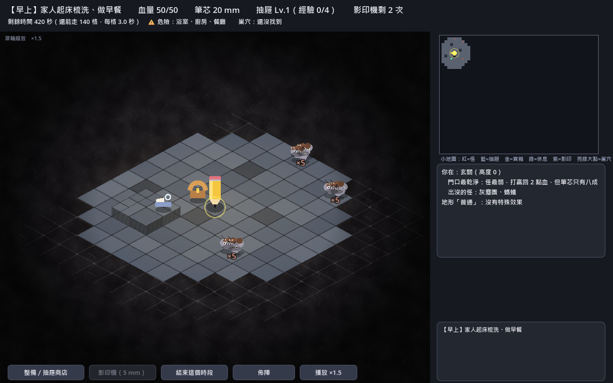
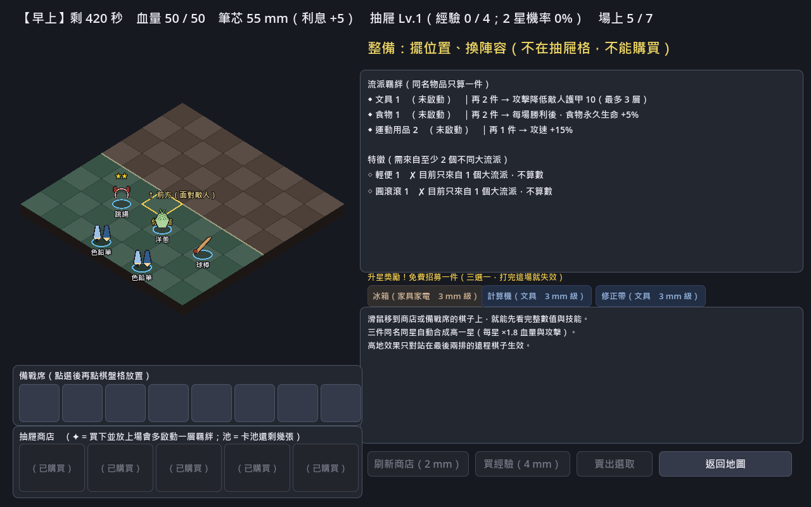
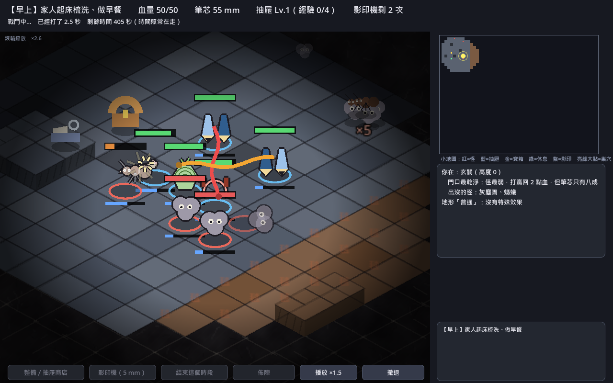

# 鉛棋百怪（Pencil Auto Battler）

用 **Godot 4** 製作的自走棋遊戲原型。玩家扮演魔法鉛筆，用筆芯把日常物品「寫」成會戰鬥的棋子，在房子裡探索、組隊、自動戰鬥，天黑前趕到魔王巢穴決戰。

> 目前是單人測試版（MVP），完整的多人合作版設計見《遊戲設計企劃書》。

| 探索 | 整備 | 戰鬥 |
|---|---|---|
|  |  |  |

## 玩法

- **時間制探索**：一天分早、午、晚三個時段，每走一格、每打一場都會消耗時間。
- **自走棋戰鬥**：在棋盤上擺陣後自動開打；站的格子決定戰場地形，例如地毯會減速、書桌高處能增加射程、濕滑地板可能滑過頭。
- **流派與升星**：29 種物品分成文具、食物、運動用品等流派，湊齊同流派可以啟動羈絆；三件同名物品會自動合成升星。
- **家人作息**：不同時段家人會佔用不同房間，誤闖會扣血，還可能被收走物品。
- **最終決戰**：天黑後趕到隨機出現的魔王巢穴，離得越遠扣血越多，抵達後連打 5 波。

## 技術重點

### 戰鬥「先算完，再播放」

`scripts/sim/battle_sim.gd` 是**純資料的戰鬥模擬**，不碰任何節點或畫面：

- 固定時間步（每 0.1 秒一步，最長 40 秒）、固定隨機種子。
- 一次算完整場戰鬥，每一步存成快照；畫面（`battle_fx.gd`）只負責播放。
- **同樣的陣容加上同樣的種子，一定得到同樣的結果**，所以可以寫自動化測試，播放速度（×1／×1.5／×3）也不會影響勝負。

### 資料驅動

物品、流派、敵人、地圖、地形、魔王波次都寫在 `data/*.json`，調整平衡不用改程式。

### 自動化測試

`tests/` 底下的測試都可以用 headless 模式執行：

| 測試 | 檢查內容 |
|---|---|
| `explore_test.gd` | 地圖完整性、確定性，並讓機器人實際跑完一天 |
| `skills_test.gd` | 每件物品都實際施放一次技能 |
| `pool_test.gd` | 卡池與商店刷新 |
| `arena_test.gd` | 可變大小的戰場、障礙物、高低差 |
| `field_test.gd` | 在大地圖上就地開打：切換戰場、展開陣形、不重複扣時間 |
| `click_test.gd` | 送出真的滑鼠事件，確認點擊會移動、會開打 |

## 專案結構

```
data/        物品、流派、敵人、地圖、地形、魔王波次（JSON）
scenes/      主場景
scripts/
  sim/battle_sim.gd   純資料戰鬥模擬（不依賴節點）
  game_state.gd       筆芯、商店、備戰席、棋盤、升星、流派
  map_state.gd        探索：地圖、時段、位置、血量、遭遇
  explore_screen.gd   地圖畫面與點擊移動
  battle_fx.gd        戰鬥表演（撲擊、彈道、傷害數字）
  art.gd              全部美術以程式繪製
tests/       自動化測試
docs/        開發筆記與截圖
```

## 執行

需要 Godot 4.x。

```bash
# 開啟遊戲（或用 Godot 編輯器開啟本資料夾按 F5）
godot --path .

# 執行測試（以探索測試為例）
godot --headless --path . --script tests/explore_test.gd
```

> `click_test.gd` 要送真的滑鼠事件，不能加 `--headless`。

## 文件

- [遊戲設計企劃書](雙人共棋盤自走棋｜遊戲設計企劃書.md)：完整的多人合作版設計
- [MVP Demo 規格](鉛棋百怪_MVP_Demo規格.md)
- [開發筆記](docs/MVP_NOTES.md)：目前進度、規則細節，以及與企劃書不同的決定
